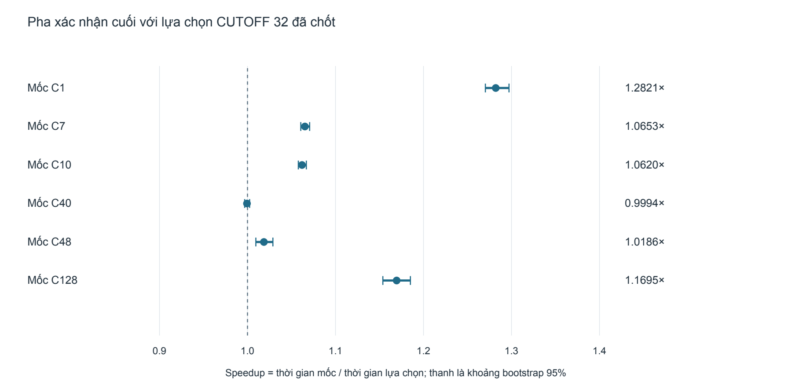

# MergeScope

Thực nghiệm lựa chọn ngưỡng chuyển sang Insertion sort trong cài đặt MergeSort của sinh viên. Project gồm mã Java, công cụ Python, dữ liệu và số đo gốc, báo cáo cùng demo tương tác ngoại tuyến.

**Kết quả đo ngày 13/11/2026:** đề xuất CUTOFF 32 cho workload Integer[] trên MacBook Air M3 16 GB, Oracle Java 25.0.2. Kết quả xác nhận cho thấy cải thiện so với CUTOFF 7 và 10; chưa đủ bằng chứng để kết luận CUTOFF 32 và 40 khác nhau về hiệu năng.

## Nội dung project

| Nội dung | Tệp và thư mục |
|---|---|
| Báo cáo và đồ thị | [PDF 10 trang](report/Cutoff_Study.pdf), [Word](report/Cutoff_Study.docx), [Markdown](report/Cutoff_Study.md), [bốn đồ thị](report/charts/) |
| Mã nguồn và script | [MergeSort.java](src/MergeSort.java), [cutofflab.py](cutofflab.py), [labcore](labcore/) |
| Dữ liệu đầu vào | [180 mảng CSV](datasets/), index và SHA-256 trong từng pha |
| Số đo và phân tích | [measurements](measurements/), [thống kê mô tả](measurements/confirm/descriptive-times.csv), [so sánh ghép cặp](measurements/confirm/paired-effects.csv), [kết quả xác nhận](measurements/confirm/summary.json) |
| Công bố AI | [Phạm vi hỗ trợ AI](docs/AI_DISCLOSURE.md) |
| Demo tương tác ngoại tuyến | Tải hoặc clone project, mở [demo/index.html](demo/index.html) bằng trình duyệt |

Giữ nguyên cấu trúc thư mục khi mở demo để các liên kết tới CSS, JavaScript và báo cáo PDF hoạt động. Demo dùng tài nguyên trong project và chạy ngoại tuyến. GitHub hiển thị mã nguồn khi mở HTML ở tab Code; cần tải hoặc clone project để chạy demo trên máy.

## Kết quả trong phạm vi thí nghiệm

| Mốc so sánh | Speedup của C32 | Khoảng bootstrap 95% |
|---|---:|---:|
| C1 | 1.2821 | 1.2703 đến 1.2972 |
| C7 | 1.0653 | 1.0606 đến 1.0706 |
| C10 | 1.0620 | 1.0578 đến 1.0669 |
| C40 | 0.9994 | 0.9968 đến 1.0024 |

Speedup = thời gian mốc / thời gian C32. Trước C10, mức giảm thời gian khoảng 5,83%. Kết luận giới hạn trong cài đặt, dữ liệu và cấu hình đã đo; không khẳng định một cutoff tối ưu duy nhất cho mọi máy.



Ba pha được chốt trước: sàng lọc 69 ngưỡng → chọn trong ba đại diện trên tập mới → xác nhận lựa chọn đã đóng băng. Có **180 mảng CSV, 91.500 quan sát batch và 126.225 sort trong vùng đo**. Seed và kích thước tách biệt giữa ba pha; giữ mọi quan sát, kể cả các quan sát chậm.

## Cấu trúc repository

```text
mergescope/
├── .github/workflows/ci.yml     # Kiểm tra trên JDK 17 và 25
├── src/                        # MergeSort nguyên bản và harness đo Java
├── tests/                      # Kiểm thử Java, Python và viewer
├── labcore/                    # Sinh dữ liệu, đo, thống kê, kiểm toán, báo cáo
├── tools/                      # Ghi trace, kiểm tra repo, đóng gói
├── datasets/                   # 180 mảng CSV cùng index và hash
│   ├── screen/
│   ├── choose/
│   └── confirm/
├── measurements/               # Raw CSV, thống kê, metadata, log và snapshot
├── report/                     # PDF, DOCX, Markdown và bốn đồ thị
├── demo/                       # HTML/CSS/JS; trace được nhúng sẵn
├── docs/                       # Giao thức, nguồn gốc và công bố phạm vi AI
├── cutofflab.py                # Điểm vào CLI của thí nghiệm
├── study.json                  # Giao thức ba pha đã định trước
├── Makefile                    # Các lệnh tắt trên macOS/Linux
├── .gitattributes              # Giữ byte để bảo toàn SHA-256
├── .gitignore                  # Loại build/cache; giữ dữ liệu và log thí nghiệm
├── CHECKSUMS.txt               # Hash của bản repository hiện tại
└── CREATION_LEDGER.csv          # Nguồn tạo của từng tệp
```

[Danh sách SHA-256](docs/BASELINE_SHA256.txt) dùng để kiểm tra tính toàn vẹn của mã nguồn, dữ liệu và tài liệu trong phiên bản nộp. Mỗi pha lưu bản chụp mã nguồn trong source-snapshot để đối chiếu cài đặt đã dùng khi đo.

## Kiểm tra trên máy

Cần JDK 17+, Python 3.10+ và Node.js 22+ để chạy đủ các kiểm tra. Đo, phân tích và xác minh dùng thư viện chuẩn; Node chỉ dùng các module có sẵn.

```sh
python3 cutofflab.py test
python3 -m unittest discover -s tests -p 'test_*.py' -v
node --test tests/test_viewer.cjs
python3 cutofflab.py verify
python3 tools/repository_check.py check
```

Hoặc trên macOS/Linux:

```sh
make check
```

Kiểm thử gồm 15.693 kiểm tra Java, các ca thống kê và quản lý repository, cùng 768 tổ hợp viewer với 4.716 bước chuyển. [Workflow CI](.github/workflows/ci.yml) chạy khi push main, mở pull request hoặc được chạy thủ công. CI kiểm tra tính đúng và dữ liệu đã lưu, giữ nguyên số đo máy M3; không dùng thời gian trên runner để thay kết quả báo cáo.

Phạm vi kiểm thử, kết quả xác minh và giới hạn đánh giá được trình bày trong [VALIDATION.md](docs/VALIDATION.md).

## Đo lại trên máy khác

```sh
python3 cutofflab.py study --new-run lan_do_moi
```

Mỗi phiên đo được lưu riêng trong reruns/, gồm cấu hình và kết quả của cả ba pha. Kết quả của các phiên đo độc lập được diễn giải theo cấu hình máy và dữ liệu tương ứng.

```java
Integer[] data = {8, 3, 7, 3, 1};
MergeSort.sort(data, 32);
```

Nguồn gốc và SHA-256 của cài đặt được ghi trong [ORIGIN.json](docs/ORIGIN.json). Thiết kế thí nghiệm được mô tả trong [PROTOCOL.md](docs/PROTOCOL.md) và [study.json](study.json).

## Dựng lại báo cáo và demo

Báo cáo PDF và demo HTML được cung cấp sẵn trong repository. Lệnh tái tạo demo:

```sh
python3 cutofflab.py demo
```

Báo cáo Word, Markdown và bốn đồ thị được tái tạo bằng lệnh sau, với các thư viện được liệt kê trong [doc-build-requirements.txt](doc-build-requirements.txt):

```sh
python3 cutofflab.py report
```

Tệp DOCX được xuất sang PDF bằng Word hoặc LibreOffice. Phiên bản thư viện được ghi trong [BUILD_ENVIRONMENT.json](docs/BUILD_ENVIRONMENT.json).
