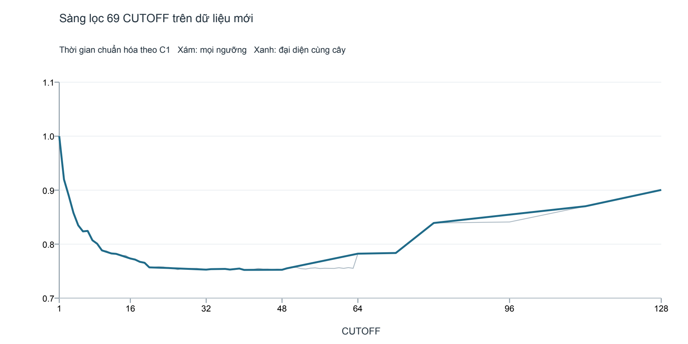
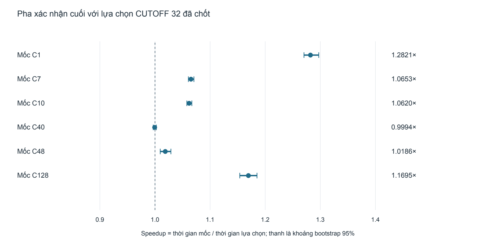
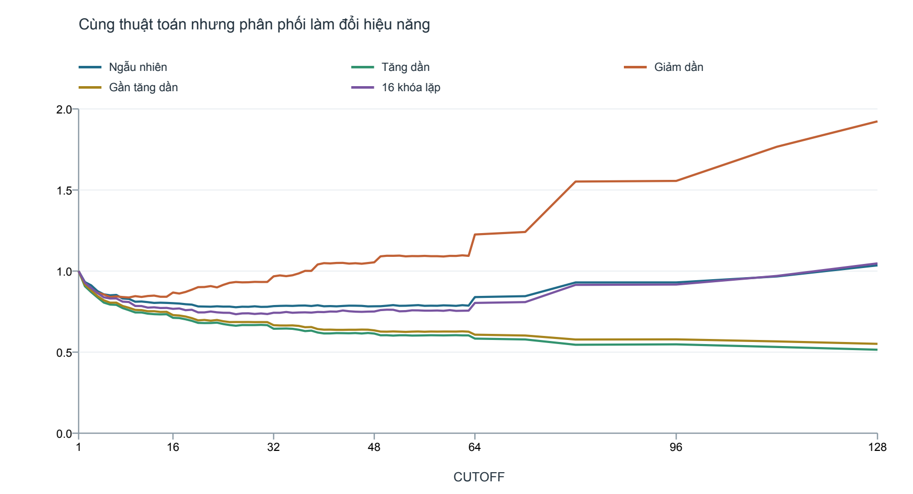
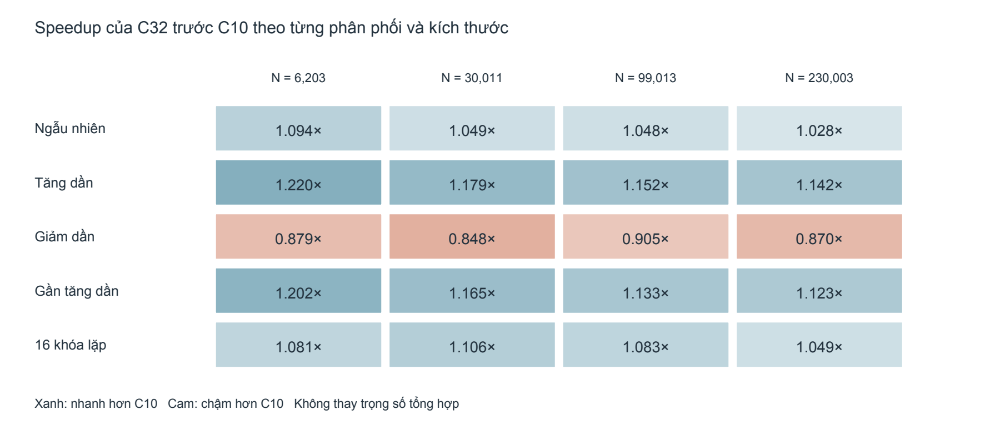

Thực nghiệm lựa chọn CUTOFF
cho MergeSort

Báo cáo phân tích thuật toán  |  Ngày 13/11/2026

Họ và tên: ____________________     MSSV: ____________________
Lớp: ____________________     Giảng viên: ____________________

### Kết luận của thí nghiệm

Đề xuất CUTOFF 32 cho cài đặt MergeSort được khảo sát và workload Integer[] đã xác định. Trên tập xác nhận cuối, speedup so với CUTOFF 7 là 1.0653 lần, so với CUTOFF 10 là 1.0620 lần. Tỷ lệ giảm thời gian trước mốc 10 là 5.83%.

Khoảng 95% trước mốc 40 chứa 1, chưa phân biệt rõ hai lựa chọn. Khuyến nghị là một lựa chọn thực dụng trong vùng gần tối ưu; không xác định một hằng số nhanh nhất duy nhất cho mọi kích thước, kiểu dữ liệu và máy.

| Chỉ tiêu | Sàng lọc | Chọn | Xác nhận |
| --- | --- | --- | --- |
| Số mảng | 60 | 60 | 60 |
| Ứng viên đo | 69 | 7 | 7 |
| JVM × vòng đo | 3 × 5 | 5 × 7 | 5 × 7 |
| Quan sát batch | 62.100 | 14.700 | 14.700 |
| Sort trong vùng đo | 93.150 | 18.375 | 14.700 |

### Câu hỏi nghiên cứu

Mốc 7 và 10 trong đề bài cần được kiểm tra bằng thí nghiệm trên cài đặt và máy thực tế. Khi tăng cutoff, chi phí chia và trộn giảm nhưng phần Insertion sort nhận các đoạn dài hơn. Thí nghiệm xem xét sự đánh đổi đó trên nhiều thứ tự đầu vào và số khóa trùng, thay vì chỉ đo một mảng ngẫu nhiên.

Thiết kế ba pha được ghi trước khi đo: sàng lọc, chọn trên dữ liệu mới, rồi xác nhận lựa chọn đã chốt bằng dữ liệu chưa sử dụng. Cùng một cài đặt MergeSort được sử dụng ở cả ba pha để so sánh tác động của cutoff.

## 1 Mã nguồn và tính đúng

Đối tượng nghiên cứu là cài đặt trong src/MergeSort.java. Cài đặt có chia đôi đệ quy, mảng phụ dùng chung trong một lần sort, trộn bằng hai con trỏ và Insertion sort đổi chỗ kề nhau. Chỉ tham số cutoff thay đổi giữa các phép đo; không thêm nhánh bỏ merge hoặc thay cách chèn.

```text
if (hi - lo < cutoff) {
    insertionSort(a, lo, hi);
    return;
}
```

Vì hai chỉ số đầu cuối đều được tính vào đoạn, độ dài là hi - lo + 1. Điều kiện trong mã tương đương độ dài không vượt cutoff: CUTOFF 10 nhận đoạn có tối đa 10 phần tử. Với cutoff 1, cây đi đến các đoạn đơn phần tử; đây là đường cơ sở trong cùng bản cài đặt tham số hóa.

### Lập luận về tính đúng và tính ổn định

Insertion sort giữ phần đầu đoạn có thứ tự và đưa phần tử tiếp theo về vị trí thích hợp bằng các phép đổi chỗ. Sau hai lời gọi đệ quy, mỗi nửa đã tăng dần. Hai con trỏ của merge chọn phần tử nhỏ nhất còn lại và ghi lần lượt vào đoạn đích; không mất hoặc thêm phần tử.

Phép chèn chỉ đổi chỗ khi khóa bên phải nhỏ hơn thực sự. Khi merge gặp hai khóa bằng nhau, mã lấy từ nửa trái trước. Hai quy tắc này bảo toàn thứ tự tương đối của các đối tượng bằng khóa, nên thuật toán ổn định.

| Nhóm kiểm thử | Nội dung |
| --- | --- |
| Vét cạn | Mọi dãy trên {-1, 0, 1} có độ dài 0 đến 6; cutoff 1 đến 12 |
| Biên và ngẫu nhiên | Mọi cutoff 1 đến 128; N ngay trước, bằng và sau cutoff; nhiều mảng ngẫu nhiên |
| Ổn định và generic | Đối tượng có khóa trùng kèm số thứ tự; so với oracle ổn định; mảng String |
| API và giá trị cực trị | Mảng null, cutoff không hợp lệ, int nhỏ nhất/lớn nhất và mảng dài giảm dần |

Bộ kiểm thử đạt 15.693 kiểm tra độc lập. Arrays.sort chỉ dùng làm oracle ngoài vùng đo, không xuất hiện trong MergeSort.java. Mọi output của benchmark tiếp tục được đối chiếu toàn bộ bằng giá trị ngay sau lần đo, không chỉ kiểm tra mảng đã tăng dần.

Với cutoff cố định, độ phức tạp xấu nhất vẫn O(N log N); mảng phụ cần O(N), stack cần O(log N). Nếu cutoff lớn hơn hoặc bằng N, cả mảng chạy Insertion sort và xấu nhất O(N²). Đây là lý do không chọn cutoff càng lớn càng tốt.

## 2 Giao thức thí nghiệm

study.json được ghi trước khi chạy JVM đầu tiên. Sàng lọc khảo sát 69 giá trị: 1 đến 64, 72, 80, 96, 112 và 128. Ba đại diện tốt nhất có cấu trúc cây khác nhau được đưa sang pha chọn. Pha chọn chỉ so sánh ba ứng viên đã chốt và các mốc đối chiếu. Lựa chọn thắng ở pha này được giữ nguyên khi xác nhận cuối.

| Pha | Độ dài N | Seed dữ liệu |
| --- | --- | --- |
| Sàng lọc | 2.053; 10.039; 50.021; 150.053 | 481.516; 481.517; 481.518 |
| Chọn | 4.937; 21.997; 81.001; 187.987 | 820.001; 820.003; 820.007 |
| Xác nhận | 6.203; 30.011; 99.013; 230.003 | 930.011; 930.013; 930.017 |

Mỗi pha có bốn độ dài, ba seed và năm phân phối, tạo 60 mảng. Độ dài và seed tách biệt hoàn toàn giữa ba pha. Tập xác nhận không dùng để chọn lại ngưỡng. Quy tắc dừng là đúng ba pha đã định, bất kể kết quả pha cuối; không mở thêm lượt để tìm một thứ hạng ưa thích.

### Môi trường đo thực tế

| Thành phần | Giá trị ghi nhận |
| --- | --- |
| Máy | MacBook Air; Apple M3 |
| Bộ nhớ và kiến trúc | 16 GB; arm64; proc 8:4:4:0 |
| Hệ điều hành | Darwin, kernel 25.6.0 |
| Java | Oracle Corporation; 25.0.2; Java HotSpot(TM) 64-Bit Server VM |
| Cấu hình JVM | -Xms768m -Xmx768m -XX:+UseSerialGC |
| Thời điểm Việt Nam | 13/11/2026 16:27 đến 16:38 UTC+7 |

Sàng lọc dùng 3 JVM nối tiếp, mỗi JVM đo 5 vòng. Hai pha sau dùng 5 JVM, mỗi JVM đo 7 vòng. Mỗi JVM warmup tối thiểu 3 giây và mỗi mảng có một vòng thực hành không ghi số đo. Thứ tự mảng và thứ tự cutoff ở từng vòng được xáo bằng seed lưu trong cấu hình.

Các JVM chạy riêng, không đo song song. Không ghi liên tục nhiệt độ, tần số CPU hoặc tải nền; metadata phần cứng và JVM không loại bỏ hoàn toàn những nguồn biến động này. Kết quả vì vậy chỉ đại diện cho phiên máy và thiết kế được mô tả.

## 3 Dữ liệu và phương pháp thống kê

| Phân phối | Cách sinh dữ liệu |
| --- | --- |
| Ngẫu nhiên | Số nguyên đều trong [-2.000.000; 2.000.000] |
| Tăng dần | Sắp tăng bản ngẫu nhiên của cùng N và seed |
| Giảm dần | Đảo bản tăng dần |
| Gần tăng dần | Từ bản tăng, thực hiện max(1, floor(N/200)) lần đổi hai vị trí ngẫu nhiên |
| 16 khóa lặp | Các khóa 1.000.000 + 257k, k từ 0 đến 15 |

Khóa lặp có giá trị lớn để tránh tập trung vào vùng cache Integer nhỏ thông thường. Tuy nhiên ảnh hưởng của khóa trùng, cách cấp phát đối tượng và JVM vẫn chưa được tách thành các nhân tố độc lập. Dữ liệu được lưu thành 180 CSV một cột value, có seed, công thức RNG và SHA-256 trong index của từng pha.

### Phạm vi đồng hồ và đơn vị quan sát

Chỉ lời gọi MergeSort.sort được tính thời gian, bao gồm cấp phát aux mới. Đọc file, boxing, clone input và oracle đều ngoài đồng hồ. Batch có ceil(6000/N) lần sort, giới hạn từ 1 đến 8; mọi bản sao được chuẩn bị trước. Thời gian batch chia số sort tạo nanos_per_sort. Các sort trong một batch không được coi là các mẫu thời gian độc lập.

```text
khôi phục các bản sao input
đọc System.nanoTime()
gọi MergeSort.sort cho từng bản sao
đọc System.nanoTime() và lấy hiệu
kiểm tra toàn bộ output với oracle
lưu elapsed_ns và elapsed_ns / batch_size
```

Trong mỗi khối phân phối × N × seed × JVM × cutoff, lấy median qua các vòng. Điểm ứng viên là trung bình nhân của tỷ số median ứng viên trên median C1 trong cùng khối. Mọi phân phối × N có trọng số bằng nhau, đồng thời các seed và JVM cũng có trọng số bằng nhau. Không bỏ outlier sau khi xem kết quả.

Ở pha sàng lọc, các cutoff cùng cây trên toàn bộ N được nhóm theo chữ ký kích thước lá; chỉ đại diện nhỏ nhất được dùng để chọn shortlist. Số đo của các cutoff tương đương vẫn được giữ, nhưng không gộp thành thêm trọng số cho nhóm đông thành viên. Hai pha sau giữ nguyên ba ứng viên đã chốt.

Khoảng 95% dùng 4.000 bootstrap phân cấp: lấy lại JVM có hoàn lại, rồi lấy lại seed bên trong JVM, giữ cả ma trận phân phối × N của cụm đó. Các khoảng là từng cặp và không bao phủ đồng thời mọi ứng viên; chỉ có 3 hoặc 5 JVM. Quy ước gần tối ưu là thời gian cao hơn điểm thấp nhất không quá 3%, được ghi trước thí nghiệm và khác với một kết luận ý nghĩa thống kê.

## 4 Kết quả sàng lọc

Hình 1  Điểm thời gian trên tập sàng lọc  Thấp hơn là nhanh hơn



| Đại diện | Cutoff cùng cây trên N sàng lọc | Điểm so với C1 |
| --- | --- | --- |
| 1 | 1 | 1.0000 |
| 7 | 7 | 0.8245 |
| 10 | 10; 11 | 0.7885 |
| 32 | 32 | 0.7528 |
| 33 | 33; 34; 35 | 0.7537 |
| 37 | 37; 38 | 0.7529 |
| 40 | 40 đến 47 | 0.7523 |
| 48 | 48 | 0.7525 |
| 128 | 128 | 0.9004 |

Ba đại diện được chốt là 40; 48; 32. Điểm thấp nhất là 0.7523 ở đại diện 40; các điểm gần nhau chưa cho biết ứng viên nào thắng trên dữ liệu mới. Pha tiếp theo chỉ dùng shortlist này và các mốc đối chiếu đã định.

Các đoạn chỉ có một số độ dài khi chia đôi. Nếu thay cutoff mà không vượt một độ dài nút nào, cây xử lý không đổi. Khi tăng cutoff, cây chỉ được gộp dần, nên chữ ký số lượng và độ dài lá không đổi đồng nghĩa không có nút nào đổi từ chia sang lá. Số đo từng tham số vẫn có nhiễu; không chọn một cutoff tương đương chỉ vì nó có một điểm thấp hơn ngẫu nhiên.

## 5 Chốt ứng viên và xác nhận cuối

Hình 2  Speedup của C32 đã chốt  Dữ liệu xác nhận chưa dùng để chọn



| Mốc | Speedup | Khoảng bootstrap 95% | Giảm thời gian |
| --- | --- | --- | --- |
| 1 | 1.2821 | 1.2703 đến 1.2972 | 22.00% |
| 7 | 1.0653 | 1.0606 đến 1.0706 | 6.13% |
| 10 | 1.0620 | 1.0578 đến 1.0669 | 5.83% |
| 40 | 0.9994 | 0.9968 đến 1.0024 | -0.06% |
| 48 | 1.0186 | 1.0095 đến 1.0289 | 1.83% |
| 128 | 1.1695 | 1.1538 đến 1.1851 | 14.49% |

Pha chọn có điểm thấp nhất ở C32, nên ngưỡng này được lưu trong confirm-frozen.json trước JVM xác nhận đầu tiên. Speedup là thời gian mốc chia thời gian lựa chọn. Vì vậy speedup 1.0620 trước C10 tương ứng giảm 5.83% thời gian, không phải giảm 6.20%.

Khoảng 95% trước mốc 7 nằm trên 1, nghiêng về CUTOFF 32 trong thiết kế này.

Khoảng 95% trước mốc 10 nằm trên 1, nghiêng về CUTOFF 32 trong thiết kế này.

Khoảng 95% trước mốc 40 chứa 1, chưa phân biệt rõ hai lựa chọn.

Trên toàn bộ N của pha cuối, các cutoff từ 30 đến 47 có cùng cấu trúc cây. Quan hệ này khác trên tập sàng lọc. Giữ lựa chọn C32 và báo cáo đầy đủ kết quả của các ứng viên cạnh tranh, không đổi kết luận bằng cách nhìn một số đo thấp nhất của tập cuối.

Tổng ba pha có 91.500 quan sát batch và 126.225 lời gọi sort trong vùng đo. Mọi output khớp oracle; các lần warmup không tính vào hai tổng này. Hash nguồn, dữ liệu, cấu hình và quyết định đã được kiểm tra độc lập bằng cutofflab.py verify.

## 6 Phân phối và kích thước làm đổi lợi ích

Hình 3  Tỷ số thời gian theo phân phối trên tập sàng lọc



Hình 4  So sánh ghép cặp CUTOFF đã chọn với C10 trên từng ca xác nhận



Đầu vào tăng dần giúp Insertion sort gần như không đổi chỗ; cutoff lớn thường có lợi. Đầu vào giảm dần tạo nhiều nghịch thế, khiến các đoạn chèn dài đắt hơn. Hình 4 cho thấy một lợi thế tổng hợp không đồng nghĩa lợi thế trên từng loại input. Ngưỡng khuyến nghị phụ thuộc trọng số workload; nếu một ứng dụng nhận chủ yếu mảng giảm dần, cần thiết kế lại phép đo cho phân phối đó.

## 7 Thời gian tuyệt đối và độ phân tán

Bảng ghi median mili giây mỗi sort trên pha xác nhận. Mỗi ô gộp 105 quan sát batch. Đây là bảng mô tả thời gian tuyệt đối; các tỷ số trong kết luận được tính từ median của từng khối ghép cặp, không lấy tỷ số trực tiếp của các ô gộp.

| Phân phối | N | C1 ms | C10 ms | C32 ms |
| --- | --- | --- | --- | --- |
| Ngẫu nhiên | 6.203 | 0.403 | 0.328 | 0.303 |
| Tăng dần | 6.203 | 0.261 | 0.199 | 0.162 |
| Giảm dần | 6.203 | 0.268 | 0.222 | 0.254 |
| Gần tăng dần | 6.203 | 0.276 | 0.214 | 0.178 |
| 16 khóa lặp | 6.203 | 0.340 | 0.250 | 0.234 |
| Ngẫu nhiên | 30.011 | 3.080 | 2.756 | 2.647 |
| Tăng dần | 30.011 | 1.458 | 1.151 | 0.972 |
| Giảm dần | 30.011 | 1.518 | 1.294 | 1.525 |
| Gần tăng dần | 30.011 | 1.571 | 1.255 | 1.083 |
| 16 khóa lặp | 30.011 | 2.174 | 1.849 | 1.697 |
| Ngẫu nhiên | 99.013 | 11.944 | 10.930 | 10.405 |
| Tăng dần | 99.013 | 5.372 | 4.400 | 3.816 |
| Giảm dần | 99.013 | 5.521 | 4.804 | 5.305 |
| Gần tăng dần | 99.013 | 5.824 | 4.812 | 4.279 |
| 16 khóa lặp | 99.013 | 8.099 | 7.084 | 6.496 |
| Ngẫu nhiên | 230.003 | 30.344 | 27.697 | 26.883 |
| Tăng dần | 230.003 | 13.385 | 10.868 | 9.521 |
| Giảm dần | 230.003 | 13.810 | 11.893 | 13.652 |
| Gần tăng dần | 230.003 | 14.592 | 12.001 | 10.745 |
| 16 khóa lặp | 230.003 | 19.888 | 17.334 | 16.458 |

Ví dụ ngẫu nhiên N = 230.003, C32: median 26.883 ms; mean 27.219 ms; độ lệch chuẩn mẫu 3.661 ms; Q1-Q3 26.206-27.626 ms. Chưa có trace nguyên nhân để gán riêng một quan sát chậm cho GC hay tải nền.

descriptive-times.csv còn lưu min, max và MAD cho từng phân phối × N × cutoff. process-*.csv giữ các lần đo gốc, thứ tự ứng viên, batch, tổng nano giây và checksum. Độ lệch chuẩn mô tả không giả định mọi quan sát gộp là độc lập; bootstrap dùng cấp JVM và seed để phản ánh cấu trúc lặp.

## 8 Chạy lại và trình bày bằng demo

### Các bước tái lập

Cần JDK 17 trở lên và Python 3.10 trở lên để chạy đo, kiểm thử và phân tích; các bước này chỉ dùng thư viện chuẩn. Mỗi phiên tái lập được lưu riêng dưới reruns/ để bảo toàn số liệu đã công bố. Thời gian chạy lại có nhiễu nên thứ hạng không bắt buộc giống bản báo cáo.

```text
python3 cutofflab.py test
python3 -m unittest discover -s tests -p "test_*.py"
python3 cutofflab.py verify
python3 cutofflab.py study --new-run lan_do_moi
```

Giao thức, cấu hình từng pha và quyết định chốt có hash và thời điểm UTC. Mỗi pha giữ source-snapshot của các tệp Java thực sự được biên dịch. Dataset index lưu SHA-256 từng CSV. Lệnh verify kiểm tra ma trận phép đo đầy đủ, thứ tự ứng viên là hoán vị, checksum kết quả và dữ liệu tách biệt giữa ba pha.

### Demo ghi trực tiếp các phép so sánh

Mở demo/index.html để chọn N = 16 hoặc 33, đổi thứ tự đầu vào và CUTOFF từ 1 đến 128. Có nút tiến, lùi, về đầu, đến cuối, tự chạy và các mốc nhanh 1, 7, 10 cùng ngưỡng khuyến nghị. Nhãn # lưu vị trí ban đầu, giúp kiểm tra thứ tự các khóa bằng nhau sau khi hoàn tất.

TraceCapture gọi MergeSort.sort với đối tượng Comparable ghi lại compareTo. StackWalker nhận diện phép so sánh thuộc insertionSort hay merge và độ sâu ngăn xếp [3]. Mảng được chụp trước so sánh; bước kế tiếp phản ánh những lần ghi đã xảy ra. Trace được thu từ chính cài đặt dùng trong thí nghiệm; việc ghi sự kiện được đặt ở đối tượng Comparable, giữ nguyên mã MergeSort.

Có 768 lượt chạy Java thực tế, mỗi lượt đối chiếu với oracle ổn định. Chỉ gộp bản ghi khi toàn bộ chuỗi sự kiện giống nhau từng byte, còn 45 bản ghi khác nhau. Cây chia trên giao diện được dựng từ độ dài và cutoff để giải thích cấu trúc; nó không phải dữ liệu đo thời gian. Khi merge đang ghi dở, mảng có thể tạm lặp phần tử vì nguồn đọc là aux.

Để dựng lại demo dùng python3 cutofflab.py demo; để kiểm tra logic tương tác dùng node --test tests/test_viewer.cjs. Bộ kiểm thử sử dụng DOM tối thiểu để xác minh logic điều khiển và liên kết tài nguyên ngoại tuyến. Phạm vi này chưa bao gồm đánh giá bố cục hiển thị trong trình duyệt; chi tiết được trình bày trong docs/VALIDATION.md.

## 9 Giới hạn và công bố nguồn gốc

### Phạm vi của khuyến nghị

CUTOFF 32 là lựa chọn cho một cài đặt, kiểu Integer[], năm phân phối và trọng số đã xác định. Không suy rộng thành ngưỡng tốt nhất cho mọi máy hoặc mọi kiểu Comparable. Đổi sang int[], chuỗi dài, compareTo đắt, cách chèn bằng dịch phần tử hoặc phép merge khác có thể làm đổi ngưỡng.

Lưới sàng lọc hữu hạn, tối đa 128. Pha chọn và xác nhận chỉ giữ ba đại diện cùng các mốc kiểm soát, không đo lại toàn bộ lưới. Bootstrap giữ cố định các phân phối và kích thước; một phiên máy và số JVM hạn chế chưa bao phủ nhiệt độ, tải nền hoặc mọi cấu hình JIT. Khoảng từng cặp không chứng minh tối ưu tuyệt đối hoặc tương đương thống kê của toàn vùng.

Vùng gần tối ưu 3% là quy ước thực dụng đã chốt. Cùng cây đệ quy là tính chất cấu trúc của cài đặt trên N cụ thể, không buộc thời gian máy bằng nhau hoàn toàn. Không chọn lại sau pha xác nhận và không mở thêm một pha để thay kết quả. Quicksort không thuộc phần thí nghiệm MergeSort được giao trong ảnh đề.

### Nguồn mã và phạm vi hỗ trợ AI

Cài đặt MergeSort do sinh viên xây dựng được lưu tại src/MergeSort.java và sử dụng thống nhất ở cả ba pha. SHA-256 của tệp được đối chiếu với bản chụp mã nguồn và metadata của từng pha để xác minh sự thống nhất giữa mã chương trình và số đo.

```text
SHA-256 MergeSort.java
797fa52661500ca38bca2ea8cdf02497b3c8f54cb5bac8e63a032b85463a9d45
```

AI tạo các thành phần phụ trợ gồm bộ kiểm thử, công cụ đo và phân tích, bộ sinh dữ liệu, đồ thị, demo, đồng thời biên soạn bản thảo báo cáo và tài liệu. Thời gian thực nghiệm được thu từ các lần chạy Java trên cấu hình đã mô tả. Phạm vi hỗ trợ và nhật ký trao đổi được công bố tại docs/AI_DISCLOSURE.md và docs/AI_SESSION_LOG.md.

### Tài liệu tham khảo

[1] Đề bài thực nghiệm lựa chọn CUTOFF cho MergeSort. Các yêu cầu sản phẩm được đối chiếu trong docs/REQUIREMENTS.md.

[2] Oracle Java SE 25 API. System.nanoTime. Đo khoảng thời gian bằng hiệu hai lần đọc cùng JVM; độ chính xác đơn vị nano giây không bảo đảm độ phân giải một nano giây. https://docs.oracle.com/en/java/javase/25/docs/api/java.base/java/lang/System.html#nanoTime()

[3] Oracle Java SE 25 API. StackWalker. https://docs.oracle.com/en/java/javase/25/docs/api/java.base/java/lang/StackWalker.html  Truy cập ngày 13/11/2026.
